<div align="center">


<br /><br />

# Lantern
### Illuminate Your Path, Master Any Skill.
#### The modern, domain-agnostic learning experience platform (LMS / LXP) engineered for deep retention.

A universal, gamified learning platform featuring bite-sized daily challenges, multi-modal lessons (interactive quizzes, embedded video masterclasses, rich markdown study guides), personal cloud notebooks, streak momentum, a native credit-based economy, and a full administrative studio to author curricula in **any field or discipline**.

<br />

<p align="center">
  &nbsp;
  &nbsp;
  &nbsp;
  &nbsp;
  &nbsp;
  &nbsp;
  &nbsp;
  &nbsp;
  &nbsp;
  &nbsp;
  
</p>

</div>

---

## Overview

Lantern is a modern, domain-agnostic Learning Experience Platform (LMS / LXP) engineered to make learning in **any discipline** engaging, durable, and self-directed. While it ships with a pre-configured seed catalog of 5 technology and venture tracks to showcase its capabilities out-of-the-box, the underlying architecture is universally designed to host courses on **any topic**—from languages, law, and medical sciences to test prep, arts, and executive training:

- **Unified Command Dashboard (`/dashboard`)**: Instant high-level learner command center displaying real-time streak momentum, knowledge score (XP), focus energy (hearts), and credit balance, alongside an active course progress tracker, "Up Next" lesson launcher, and 1-click course switcher.
- **Multi-Modal Learning Formats**:
  - **Interactive Knowledge Checks**: Bite-sized, gamified multiple-choice challenges with instant evaluation, audio SFX, and numbered keyboard shortcuts (`1`, `2`, `3`).
  - **Deep-Dive Reading Guides**: Rich markdown lessons with syntax-highlighted code blocks, tables, one-click copying, and downloadable external resources.
  - **Video Masterclasses**: Responsive embedded video lectures (YouTube, Vimeo, or direct MP4/WebM) with integrated completion tracking.
- **Universal Curriculum Architecture (Seeded Reference Demo)**:
  - *Full-Stack React 19 & Next.js App Router* (Server Primitives, Streaming SSR, Optimistic UI)
  - *AI & Applied LLM Engineering* (Structured Outputs, RAG, Tool Calling, Vector Search)
  - *Tech Startup Strategy & SaaS Finance* (Unit Economics, CAC Payback, Term Sheets & SAFEs)
  - *Cloud Architecture & High Scalability* (CAP Theorem, Raft Consensus, Resilient Queues)
  - *UI/UX Product Design & Systems* (8pt Grid, Design Tokens, WCAG AA Accessibility)
  - *(Easily create custom courses for any domain via the Admin Studio or API)*
- **Administrative Control Plane (`/admin`)**: Built-in curriculum authoring studio to create, update, and manage custom courses, modules, lessons, and challenge question banks for any field of study.
- **Personal Study Notebook (`/notebook`)**: Cloud-synced learner notebook auto-saving takeaways, notes, and reflections per lesson directly to Convex.
- **Zero-Clerk Native Authentication**: In-database email and password authentication stored in Convex (`users` & `sessions`) with SHA-256 password hashing + 16-byte random salt, zero external auth provider lock-in, and humanized error handling.
- **Gamification & Retention Engine**:
  - Focus energy system (5 hearts) with practice review mode to regenerate energy.
  - Daily streaks, XP milestones, and daily quests (`/quests`).
  - Real-time reactive leaderboard (`/leaderboard`) with track-specific vs global rankings.
  - Built-in credit economy with 100 free welcome credits on signup for Pro upgrades or refills.

---

## Universal Curriculum Architecture & Seed Showcase

Lantern is completely domain-agnostic. Educators, organizations, and platform admins can author, structure, and publish courses on **practically any subject or skill**. To demonstrate the full breadth of the multi-modal lesson engine upon initial installation, Lantern includes 5 comprehensive reference tracks:

<table>
  <tr>
    <td align="center" width="160">
      <br />
      <sub><b>Full-Stack Engineering</b><br/>React 19, Next.js, RSC & Convex</sub>
    </td>
    <td align="center" width="160">
      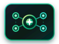<br />
      <sub><b>Applied AI Engineering</b><br/>LLMs, RAG, Tool Calling & Zod</sub>
    </td>
    <td align="center" width="160">
      <br />
      <sub><b>Startup Strategy & SaaS</b><br/>CAC Payback, Cap Tables & SAFEs</sub>
    </td>
    <td align="center" width="160">
      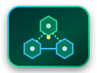<br />
      <sub><b>Cloud & Scalability</b><br/>CAP Theorem, Raft & Microservices</sub>
    </td>
    <td align="center" width="160">
      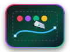<br />
      <sub><b>UI/UX Design Systems</b><br/>8pt Grid, Tokens & WCAG AA</sub>
    </td>
  </tr>
</table>

---

## Reactive Cloud Architecture

Lantern features a clean, reactive architecture powered by Next.js 14 App Router and Convex Cloud with live WebSocket subscriptions:

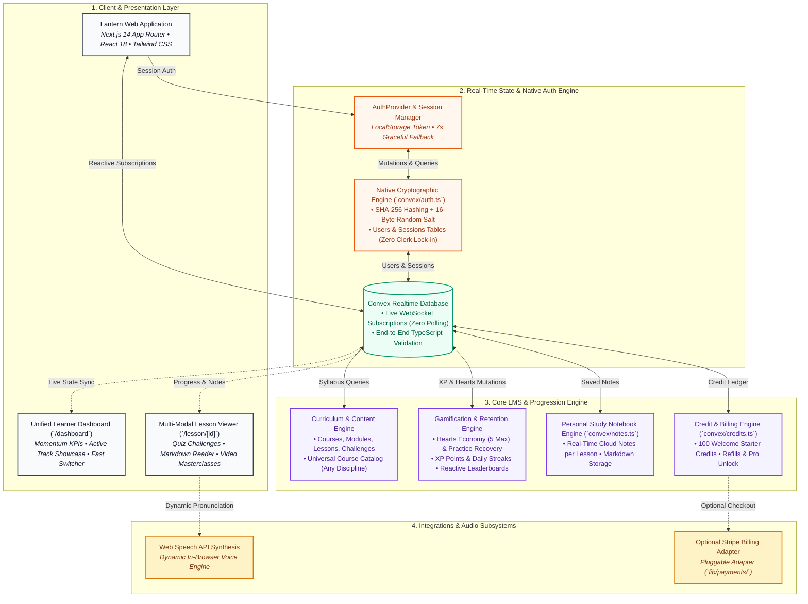

<br />

### Architectural Highlights
1. **Zero External Auth Vendor Lock-In**: Complete replacement of third-party auth (Clerk) with an in-database salted SHA-256 cryptographic engine stored inside Convex (`users` and `sessions` tables).
2. **Live WebSocket State Sync**: All course progress, XP tallies, heart decrements, notes, and leaderboards update in real time with zero client polling.
3. **Multi-Modal Content Ingestion**: Supports interactive quiz challenges (`SELECT`, `ASSIST`), rich markdown articles with syntax highlighting, and responsive video players across any created course.
4. **Pluggable Payment Engine**: Runs smoothly on internal credit tokens (100 welcome credits granted on signup) with optional Stripe checkout adapter.

---

## Product Showcase & Platform Walkthrough

A visual walkthrough of the Lantern platform across learner workflows and administrative operations:

<table>
  <tr>
    <td width="50%" valign="top">
      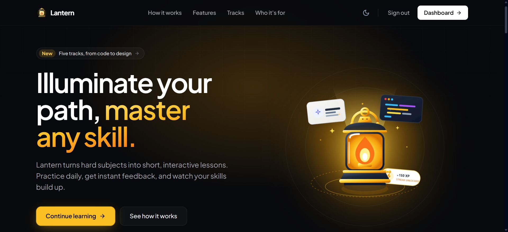
      <br /><br />
      <b>01. Landing page (<code>/</code>)</b><br />
      <sub>Dark-mode landing experience featuring radiant Solar Amber beacon artwork, track highlights, platform stats, and one-click onboarding.</sub>
    </td>
    <td width="50%" valign="top">
      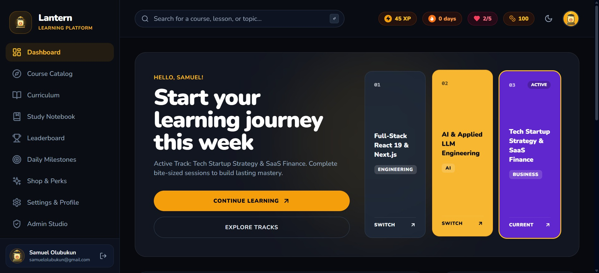
      <br /><br />
      <b>02. Unified Learner Command Dashboard (<code>/dashboard</code>)</b><br />
      <sub>Central learning command hub displaying active track progress, one-click track switcher cards, streak momentum, XP metrics, and next lesson launcher.</sub>
    </td>
  </tr>
  <tr>
    <td width="50%" valign="top">
      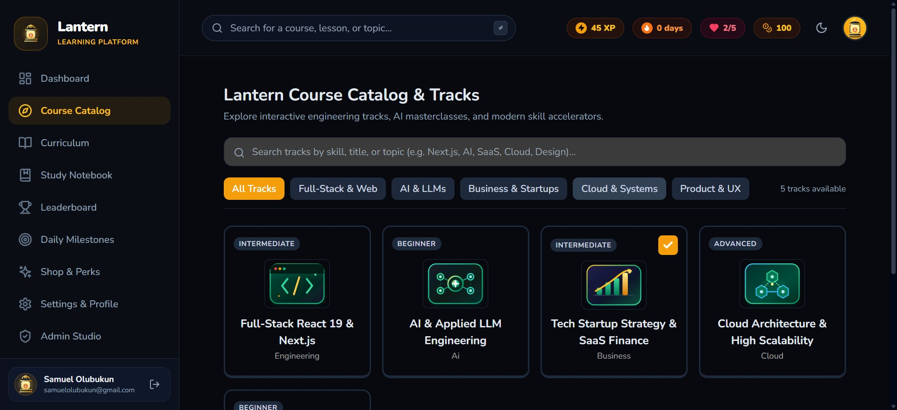
      <br /><br />
      <b>03. Multi-Domain Course Catalog (<code>/courses</code>)</b><br />
      <sub>Searchable curriculum library displaying all active courses with level filters and instant enrollment (pre-loaded with 5 reference tracks).</sub>
    </td>
    <td width="50%" valign="top">
      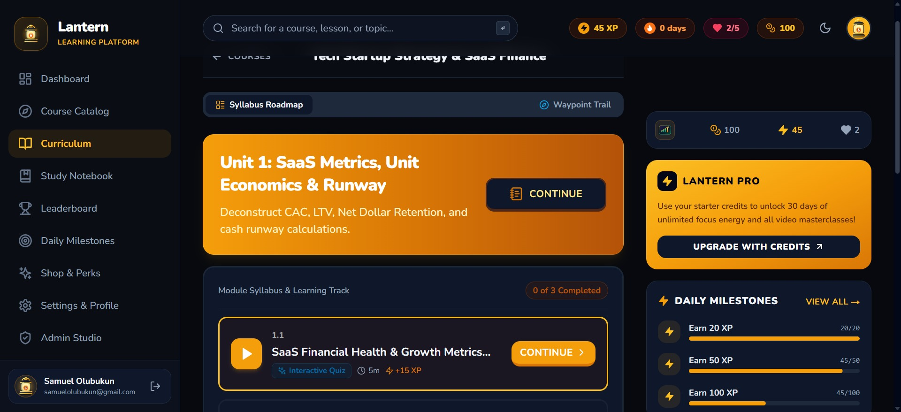
      <br /><br />
      <b>04. Curriculum Syllabus & Learning Roadmap (<code>/learn</code>)</b><br />
      <sub>Structured unit progression with multi-modal lesson waypoints, completion counters, right-rail Pro pass access, and milestone quests.</sub>
    </td>
  </tr>
  <tr>
    <td width="50%" valign="top">
      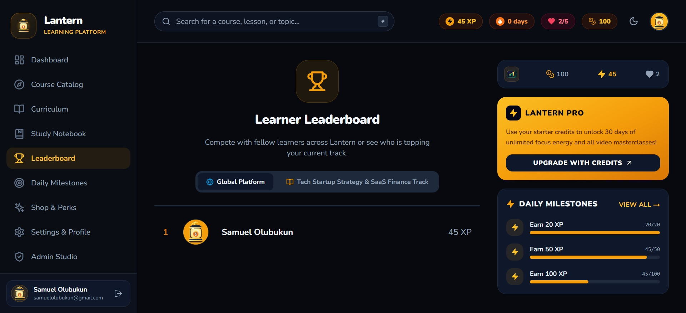
      <br /><br />
      <b>05. Reactive Learner Leaderboard (<code>/leaderboard</code>)</b><br />
      <sub>Competitive platform rankings powered by live Convex WebSocket subscriptions, tracking XP milestones, streak leaders, and global learner progress.</sub>
    </td>
    <td width="50%" valign="top">
      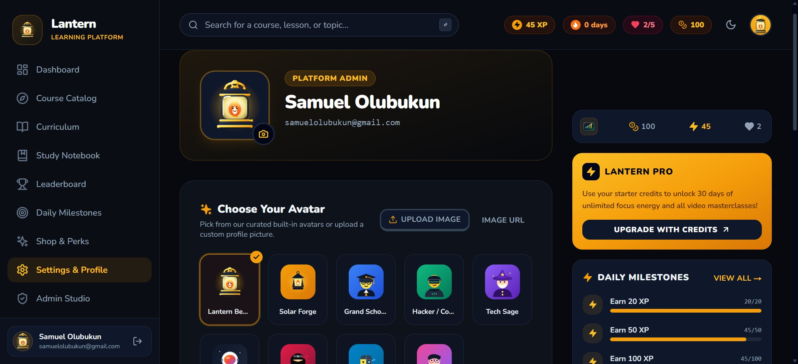
      <br /><br />
      <b>06. Account Settings & Avatar Studio (<code>/settings</code>)</b><br />
      <sub>Learner profile customization featuring 9 curated built-in vector avatars, custom photo upload with client-side canvas optimization, and credential security.</sub>
    </td>
  </tr>
  <tr>
    <td width="50%" valign="top" colspan="2">
      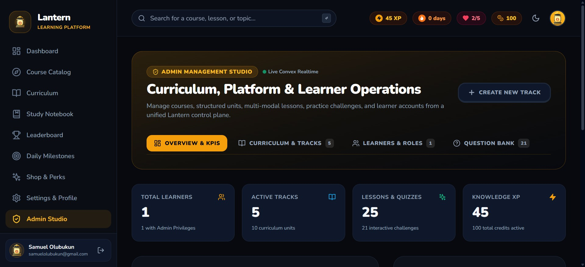
      <br /><br />
      <b>07. Admin Management Studio & Control Plane (<code>/admin</code>)</b><br />
      <sub>Unified platform operations hub with high-level KPIs, visual curriculum hierarchy tree builder, interactive quiz question bank, and learner role management.</sub>
    </td>
  </tr>
</table>

---

## Core Product Capabilities Breakdown

### 1. Unified Dashboard (`/dashboard`)
- **4 Metric Cards**: Instant visibility over Daily Streak (🔥), Total XP (⚡), Focus Energy (💖), and Learning Credits (🪙).
- **Active Track Showcase**: Shows current track artwork, title, description, and percentage completion bar.
- **Up Next Action**: Displays the next unfinished lesson title, estimated time, and direct link.
- **Track Switcher**: Easily switch between enrolled courses with 1-click.

### 2. Multi-Modal Lesson Viewer (`/lesson/[lessonId]`)
- **Interactive Quizzes**:
  - Multiple-choice options with shortcut keys (`1`, `2`, `3`).
  - Active selection glow in Lantern Solar Amber (`#F59E0B`).
  - Correct answers highlighted in vibrant emerald; errors highlighted in rose with heart loss.
  - Success chime, error buzzer, and victory confetti celebration upon lesson completion.
- **Architecture Articles**:
  - Rendered with zero-dependency `MarkdownRenderer` supporting H1, H2, H3, lists, bold, blockquotes, and inline code.
  - Formatted code snippets with a 1-click **Copy** button.
  - Downloadable resource links and external documentation references.
- **Video Masterclasses**:
  - Responsive embedded video player supporting YouTube, Vimeo, and direct MP4/WebM files.

### 3. Personal Study Notebook (`/notebook`)
- **Integrated Tab**: Write notes directly while viewing lessons or review all notes in the central `/notebook` hub.
- **Instant Cloud Sync**: Notes save automatically to Convex (`notes` table) with zero risk of lost work.
- **Search & Navigation**: Search notes by keyword and click through directly to the originating lesson.

### 4. Zero-Clerk Native Authentication
- **Secure Storage**: Passwords hashed using standard Web Cryptography (`SHA-256`) with unique 16-byte random hex salts.
- **Session Management**: Cryptographically secure session tokens stored in Convex `sessions` and client `localStorage`.
- **Automatic Onboarding**: New users automatically receive 100 free Lantern welcome credits and enrollment in the introductory course.
- **Humanized Error Handling**: Replaces raw server exception stacks with friendly messages.

---

## Deployment & Setup Guide

### 1. Prerequisites
- **Node.js**: `v18.17.0` or higher (Node 20+ recommended)
- **npm**: `v9.0.0` or higher
- **Convex Account**: Free cloud real-time backend ([convex.dev](https://convex.dev))

---

### 2. Configure Environment Variables

Create a `.env.local` file in the project root:

```env
# Application Host
NEXT_PUBLIC_APP_URL=http://localhost:3000

# Convex Real-Time Cloud Backend
CONVEX_DEPLOYMENT=dev:<your-deployment-name>
NEXT_PUBLIC_CONVEX_URL=https://<your-deployment-name>.convex.cloud

# Optional: Stripe Integration (leave empty to use Credit-based economy)
STRIPE_API_KEY=
STRIPE_WEBHOOK_SECRET=
NEXT_PUBLIC_STRIPE_PUBLISHABLE_KEY=
```

---

### 3. Install Dependencies

```bash
npm install
```

---

### 4. Start the Convex Real-Time Backend

In a dedicated terminal, launch the Convex development daemon:

```bash
npm run convex:dev
```

*This will connect to your Convex deployment, generate TypeScript types, and watch `convex/` for changes.*

---

### 5. Seed the Multi-Domain Curriculum

Populate the database with the 5 comprehensive tracks, modules, lessons, and challenges:

```bash
npm run convex:seed
```

---

### 6. Launch the Next.js Development Server

In a second terminal, start Next.js:

```bash
npm run dev
```

Open [http://localhost:3000](http://localhost:3000) in your browser.

---

### 7. Production Build Verification

To verify full static generation and type safety across all 23 routes:

```bash
npm run build
```

---

## Project Structure

```
lantern/
├── app/                  # Next.js App Router (Landing, Dashboard, Curriculum, Admin, Lesson Runner)
│   ├── (auth)/           # Native authentication (login & registration)
│   ├── (landing)/        # Marketing portal & hero experience
│   ├── (main)/           # Core learner views (dashboard, courses, learn, leaderboard, settings, shop)
│   ├── admin/            # Unified platform administration studio & curriculum operations
│   └── lesson/           # Multi-modal interactive lesson runner (quizzes, articles, video)
├── components/           # UI primitives, responsive sidebars, headers, and modal dialogs
├── convex/               # Convex real-time cloud backend (schema, auth, gamification, seed data)
├── lib/                  # Helper utilities, avatar presets, and error formatters
├── providers/            # Client providers (AuthProvider, ConvexClientProvider, ModalProvider)
└── public/               # Vector assets, track badges, avatars, audio SFX, and screenshots
```

---


<p align="center">
  <sub>Lantern — Illuminate Your Path, Master Any Skill. A universal, gamified learning platform built for deep retention and self-paced mastery across any discipline.</sub>
</p>
